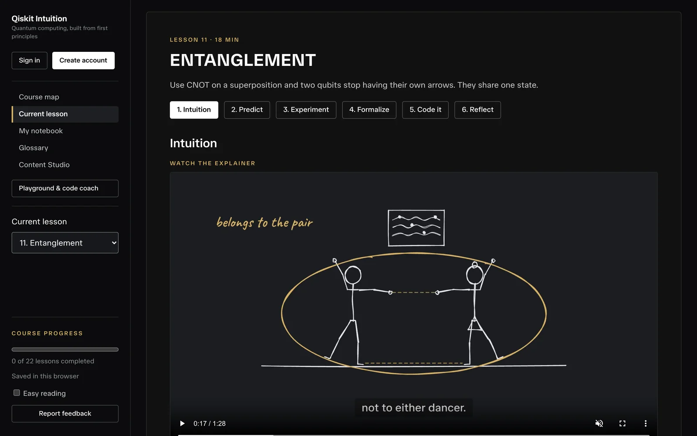
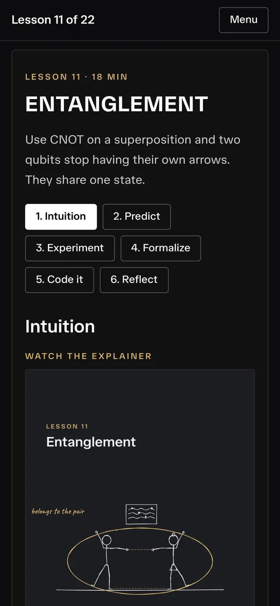
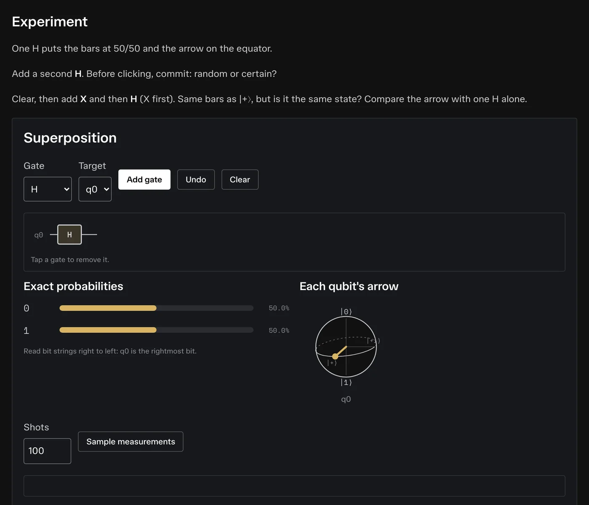
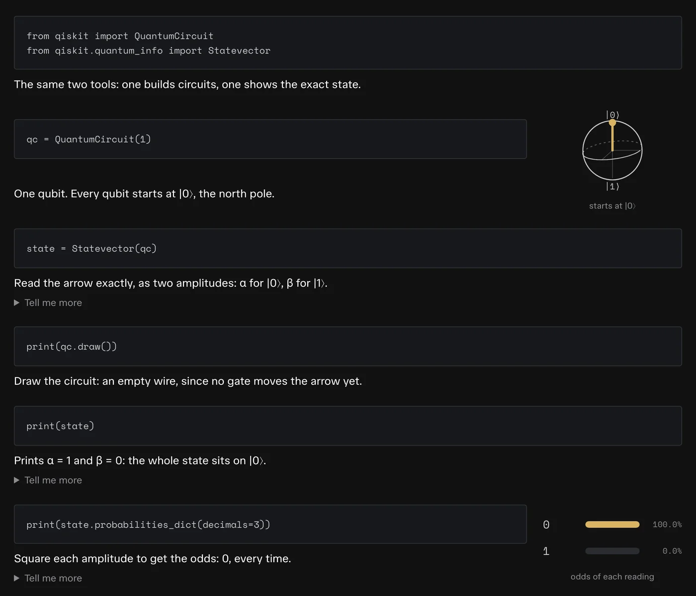
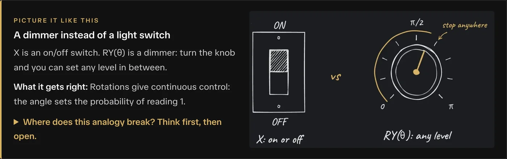
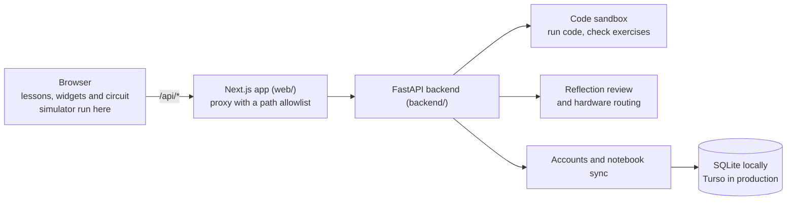
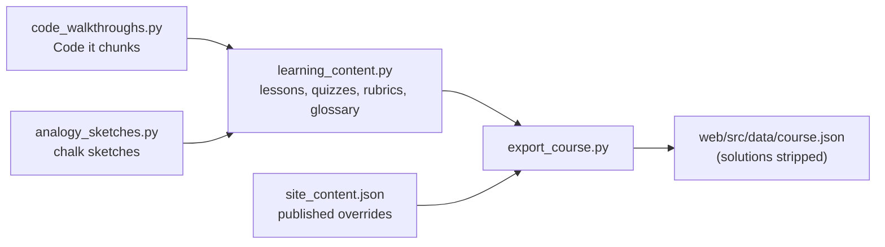

# Quantum Intuition

**Learn quantum computing and Qiskit from zero: picture first, math second, code third.**

**▶ [Open the course](https://qiskit-intuition-organization-phi.vercel.app)** · free · no sign-up needed · laptop, tablet or phone

<p align="center">
  
  &nbsp;
  
</p>

Most quantum courses open with linear algebra. This one opens with a 90-second hand-drawn video and a picture you can turn with a slider. You predict what will happen, test it in a circuit, and only then meet the math and the Qiskit code, one line at a time.

**22 lessons · about 5 hours · 22 explainer videos · 18 interactive widgets · every exercise checked automatically**

---

## How a lesson works

Every lesson walks through the same six stages.

| Stage | What you do |
| --- | --- |
| **1. Intuition** | Watch a short hand-drawn explainer, then play with an interactive widget. The goals, an everyday analogy with its chalk sketch and the full written intuition sit in a **"Prefer to read?"** fold. |
| **2. Predict** | Lock in an answer before you know it. Then see why your pick is tempting and why the right answer is right. |
| **3. Experiment** | Build the circuit gate by gate. Watch each qubit's arrow and the exact odds move, then sample simulated measurement shots. |
| **4. Formalize** | Now the math, typeset, plus the most common mistake people make with it. |
| **5. Code it** | Read the Qiskit example chunk by chunk, with one plain line per chunk and, where it helps, a small sketch of the qubit after that line. Run it, then solve an exercise that is checked automatically. |
| **6. Reflect** | Start from a one-line "remember it as", then explain the result in your own words. "Check my reasoning" shows which key ideas you covered, hints for the ones you missed, and flags a common misconception if your answer contains one. |

<table>
  <tr>
    <td width="50%"></td>
    <td width="50%"></td>
  </tr>
  <tr>
    <td align="center"><b>Experiment:</b> gates move the arrow and the odds</td>
    <td align="center"><b>Code it:</b> every chunk explained, the key steps pictured</td>
  </tr>
</table>

<p align="center">
  
  <br><sub>Every lesson has an everyday analogy that says what it gets right and where it breaks.</sub>
</p>

## Curriculum

| # | Lesson | Pictured as | Time |
| --- | --- | --- | --- |
| | **One qubit** · what a qubit is, how measurement works, how gates move the state | | |
| 1 | Why quantum computers? | Water waves through a harbour wall | 8 min |
| 2 | What is a qubit? | A weather vane you may ask only one question | 10 min |
| 3 | Flipping a qubit with X | Flipping a pancake | 10 min |
| 4 | Measurement and shots | An opinion poll | 12 min |
| 5 | Superposition with H | A compass needle pointing east, not a spinning coin | 12 min |
| 6 | Rotations: dialing in probability | A dimmer instead of a light switch | 12 min |
| 7 | Phase: the hidden direction | Longitude on a globe | 14 min |
| 8 | Interference | Noise-cancelling headphones | 15 min |
| 9 | Measuring in other directions | Polarized sunglasses | 12 min |
| | **Many qubits** · registers, bit order and entanglement | | |
| 10 | Many qubits and bit order | A combination lock | 10 min |
| 11 | Entanglement | Two dancers sharing one routine | 18 min |
| 12 | Why you can't copy a qubit | A photocopier that only understands black and white | 12 min |
| 13 | Teleportation | A fax that shreds the original | 18 min |
| 14 | Superdense coding: two bits in one qubit | A safe with two keys | 14 min |
| | **Algorithms** · using interference on purpose | | |
| 15 | Phase kickback: Deutsch's algorithm | Spotting a two-headed coin | 15 min |
| 16 | A secret string in one question | A wall of switches and a buzzer | 15 min |
| 17 | Searching with interference: Grover search | Pushing a swing | 20 min |
| 18 | The quantum Fourier transform | Hearing the notes in a chord | 18 min |
| 19 | Phase estimation: reading a hidden angle | Timing a clock hand with snapshots | 18 min |
| | **Real hardware & beyond** · noise, compilation and trainable circuits | | |
| 20 | Noise and real hardware | Whispering down a long line | 15 min |
| 21 | Running on a real chip | Seating guests at a long dinner table | 15 min |
| 22 | Trainable circuits and quantum ML | Tuning a guitar by ear | 15 min |

Lesson 1 also has a short "How to read the code" panel, so people who have never written Python can follow every example.

## What else is inside

- **A notebook that remembers.** Predictions, margin notes, explanations and code save as you go. Guests keep everything in their browser. With a free account, your notebook follows you to any device. **My notebook** collects all of it, and you can download it as JSON (to restore later) or as a Markdown write-up.
- **Safe, auto-checked Qiskit exercises.** Your code runs in a locked-down sandbox and is compared with a reference solution by state fidelity or by measurement distribution.
- **Playground & code coach.** A free circuit builder, a Qiskit code workspace, six practice challenges and a coach that reviews your code. None of it touches your course progress.
- **Glossary.** 22 terms, each with a "picture it" and a "precisely" version, plus search.
- **Made for phones too.** The sidebar folds into a Menu button, videos switch to a vertical cut, and every widget works with touch.
- **Easy reading.** One switch enlarges text and line spacing and changes the font to Atkinson Hyperlegible.
- **Report feedback.** A sidebar link opens a GitHub issue already filled in with the lesson and stage.
- **Content Studio.** Course authors can load the brand and all lessons as JSON, edit them, preview the result in their own session and download it to publish (see [Editing the course](#editing-the-course)).

## How it's built



- **Frontend: [`web/`](web/).** Next.js 16 and React. The curriculum is bundled into the app at build time, and the circuit simulator and the widgets run in the browser (only the chip-routing widget asks the backend), so lessons are instant. The browser only talks to its own origin. [`api/[...path]/route.ts`](web/src/app/api/%5B...path%5D/route.ts) forwards an allowlist of backend paths, caps request sizes, checks the Origin on account requests and forwards only the session cookie.
- **Backend: [`backend/`](backend/).** FastAPI with Qiskit. It runs learner code, checks exercises, reviews reflections, routes circuits onto a chip layout, and handles accounts and notebook sync.
- **Course content: [`frontend/`](frontend/).** The single source of truth is plain Python. [`scripts/export_course.py`](scripts/export_course.py) turns it into `web/src/data/course.json`:



- **Videos: [`video-studio/`](video-studio/).** Each explainer is an HTML animation rendered with [HyperFrames](video-studio/KIT.md) and narrated by the Kokoro `bf_emma` voice, with captions matched to the script word for word. The renders land in `web/public/videos` (a 16:9 cut, a 9:16 phone cut and a poster per lesson). The analogy sketches in `web/public/sketches` are stills cut from the same videos.

## Run it locally

You need **Node.js 22+** and **Python 3.11+**.

```bash
python -m venv .venv
. .venv/bin/activate
pip install -r requirements-dev.txt
cp .env.example .env
uvicorn backend.main:app --host 127.0.0.1 --port 8000
```

In a second terminal:

```bash
cd web
npm ci
npm run dev
```

Open **http://localhost:3000** (use `localhost`, not `127.0.0.1`: account requests are checked against `AUTH_FRONTEND_URL`).

Lessons, widgets, the simulator, the notebook and the glossary work without Python. Running code, checking exercises and reflections, hardware routing and accounts need the backend. If it runs somewhere else, set `NEXT_PUBLIC_API_URL` in `web/.env.local` (default `http://127.0.0.1:8000`). Locally, password-reset emails are not sent: they go to a database table, and `python scripts/preview_email.py` shows the newest one.

**Docker:** `docker build -t qiskit-intuition .` then `docker run --rm -p 7860:7860 -e AUTH_FRONTEND_URL=http://localhost:7860 -e AUTH_DATABASE_URL=sqlite:////tmp/auth.sqlite3 qiskit-intuition` runs the frontend and backend together on port 7860. Without those two variables, lessons and code still work but accounts do not.

## Configuration

Everything is optional locally. In production (`VERCEL=1` or `APP_ENV=production`), the starred variables are required for accounts to work. The Turso pair is required on Vercel; a server with its own persistent disk can use `AUTH_DATABASE_URL` instead.

| Variable | Where | Purpose |
| --- | --- | --- |
| `NEXT_PUBLIC_API_URL` * | frontend | The backend's HTTPS origin. Public, not a secret. It is inlined at build time, so redeploy after changing it. |
| `AUTH_JWT_SECRET` * | backend | Signs session cookies. A random value of 32+ bytes; store it as a secret. Locally, one is generated for you. |
| `AUTH_FRONTEND_URL` * | backend | The site's exact origin (HTTPS in production). Used for reset links and as the trusted Origin for account requests. |
| `TURSO_DATABASE_URL` * | backend | The hosted SQLite (Turso) database origin, `libsql://…`. Without it, a local SQLite file is used, which Vercel refuses because its disk is temporary. |
| `TURSO_AUTH_TOKEN` * | backend | The Turso access token. `TURSO_DATABASE_TURSO_AUTH_TOKEN`, the name Vercel's Turso integration creates, also works. |
| `RESEND_API_KEY`, `AUTH_EMAIL_FROM` | backend | Send password-reset email through Resend from a verified domain. Without them, production password reset is switched off. |
| `AUTH_DATABASE_URL` | backend | Local database URL. Default `sqlite:///data/auth.sqlite3`. |
| `GEMINI_API_KEY`, `GEMINI_MODEL` | backend | Optional AI notes from the Playground code coach (default model `gemini-2.0-flash`). Needs `google-genai`, which `requirements.txt` includes; on Vercel, install the `ai` extra. The built-in coach works without it. |
| `ALLOWED_ORIGINS` | backend | Extra trusted origins, comma-separated. |

## Deployment

The live site runs on **Vercel as two projects built from this repository**, and **every push to `main` redeploys both**:

- **Frontend:** Root Directory `web`, Next.js preset, Node 22. Set `NEXT_PUBLIC_API_URL` to the backend's URL.
- **Backend:** the repository root, FastAPI preset (entry point `backend.main:app`). It needs the starred backend variables above.

Vercel installs the backend's dependencies on every cold start onto a small temporary disk, so [`pyproject.toml`](pyproject.toml) keeps the runtime list lean. The `ai` (Gemini) and `plots` (matplotlib) extras stay out of it. `requirements.txt` holds everything for Docker and CI. Run `uv lock` after changing `pyproject.toml`. To check a deploy, open `/health` on the backend, then `/api/health` on the site.

More detail: [Authentication](docs/authentication.md) · [Notebook sync](docs/notebook-sync.md).

## Editing the course

- **Lessons, quizzes, rubrics, glossary:** edit [`frontend/learning_content.py`](frontend/learning_content.py).
- **Code it walkthroughs:** edit [`frontend/code_walkthroughs.py`](frontend/code_walkthroughs.py). A test makes sure the chunks cover every line of each example.
- **Analogy sketches:** add a WebP to `web/public/sketches` and its alt text and size to [`frontend/analogy_sketches.py`](frontend/analogy_sketches.py).
- **Videos:** follow [`video-studio/KIT.md`](video-studio/KIT.md).

Then run `python scripts/export_course.py` and commit the changed `web/src/data/course.json`. CI fails if the export is stale. Files in `web/src/data/` are matched by `.gitignore`, so a **new** file there needs `git add -f`.

**Content Studio** edits apply only to your own session. To publish them, download `site_content.json`, replace `frontend/site_content.json`, export and push. Note that a downloaded file with a `lessons` list replaces every lesson wholesale, so later edits to the Python files stop reaching the site until `lessons` is removed. The Studio can edit existing lessons but not add new ones. See [CONTRIBUTING.md](CONTRIBUTING.md) for the lesson format.

## Tests

```bash
python scripts/export_course.py --check
ruff check .
pytest tests -q
cd web && npm test && npm run lint && npm run build
```

CI runs all of this on every pull request and every push to `main`. The suites cover:

- **The quantum engine**, the **exercise checker** and the **reflection reviewer**.
- **The sandbox:** escape attempts, a leak of environment secrets, timeouts and memory caps.
- **The curriculum:** every worked example runs, every reference solution passes while its starter code fails, every walkthrough covers its whole example, and every sketch file exists at its stated size.
- **Accounts:** sign-up, JWT tampering, expiry and revocation, Origin checks, rate limits, single-use reset links and production-only secure cookies.
- **Notebook sync**, against both SQLite and Turso's driver, plus web tests for the three-way merge, offline saves and account switching.

## Security

- **The sandbox** only lets learner code import an allowlist of modules, blocks risky builtins and attributes before anything runs, and runs each program in a fresh process with a 15-second limit, a CPU limit and (on Linux) a memory cap. The process gets a minimal environment, so it never sees backend secrets. Pure-Python sandboxing is best-effort, so the code runner is a place to keep watching.
- **Accounts** use Argon2id password hashes, HttpOnly SameSite session cookies (Secure in production) that the server can revoke, Origin checks on every account change, database-backed rate limits, and the same answer for known and unknown emails at sign-in and password reset.
- **A daily automated review** checks the dependencies and the riskiest code and opens a pull request for each confirmed problem. Nothing reaches the live site without a maintainer's approval.

## Known limits

- **Password reset is not live yet:** the site has no email sender configured. Sign-up, sign-in and profiles work.
- **Simulated hardware:** circuits run on a simulator. The hardware lessons model a real chip's layout and noise instead of sending jobs to IBM Quantum.
- **Cold starts:** the first code run after a quiet spell can take several seconds while the backend starts.
- **Guest progress stays in one browser** until you create an account and import it.
- **On phones, the Playground has no menu** back to the lessons yet. Use the browser's back button.

## Project structure

```text
web/                          The site (Next.js 16)
  src/app/page.tsx            Course map, lessons, notebook, glossary, Content Studio
  src/app/playground/         Circuit builder, code workspace, coach, challenges
  src/app/{login,signup,profile,forgot-password,reset-password}/
  src/app/api/[...path]/      Same-origin proxy to the backend (path allowlist)
  src/components/             Widgets, Bloch sphere, circuit lab, code walkthrough, video
  src/lib/                    In-browser simulator, notebook and sync logic
  src/data/                   course.json (generated) and videos.json
  public/videos, sketches/    Lesson videos, posters and chalk sketches
  tests/                      Node tests
backend/
  main.py                     FastAPI app
  routers/                    course, execute, simulate, agents, auth
  core/                       Sandbox, exercise checker, reflection review, quantum engine, routing
  auth/                       Accounts, sessions, notebook sync, email
frontend/                     Course content: lessons, walkthroughs, sketches, published overrides
agents/                       Legacy offline tutor personas (not used by the site)
scripts/                      export_course.py, preview_email.py, serve.py (Docker)
video-studio/                 The lesson-video kit (HyperFrames + narration)
docs/                         Authentication, notebook sync, API notes, README images
tests/                        Python tests
```

The original Streamlit app (`frontend/streamlit_app.py` and its helpers) is kept only for regression tests and is not deployed. Streamlit is installed only by `requirements-dev.txt`.

## Licence

MIT. See [LICENSE](LICENSE). The fonts in `web/public/fonts` are under the SIL Open Font License, each with its licence text.
